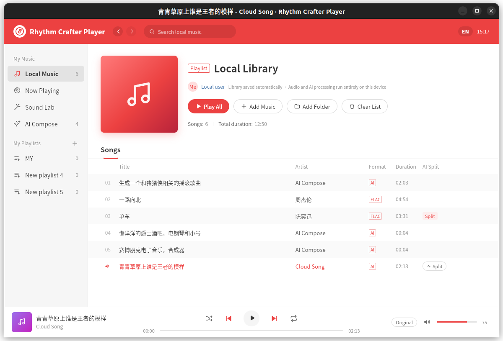

# Rhythm Crafter Player — Local AI Music Player for Quectel PI M2

English | [简体中文](README_ZH.md)

Rhythm Crafter Player is a local AI music player built for the **Quectel PI M2** smart mainboard. It combines a local music library, playlists, real-time Web Audio effects, vocal/accompaniment separation, and text-to-music generation in one desktop application.

The application is built with GTK3, WebKit2GTK, GStreamer, SQLite, and Python. AI inference runs on-device through ONNX Runtime and sherpa-onnx. It starts no HTTP server, requires no account, and keeps tracks, prompts, separated stems, and generated music on the device.

One optional feature is the exception: when Cloud Song is explicitly enabled, the application sends the music description to a user-configured Coze workflow, where the Doubao music model generates a complete song with lyrics and vocals. This feature is disabled by default, requires the user's own token, and may incur platform charges. See [Cloud Song](#cloud-song-optional-network-feature).

## Why Quectel PI M2

Quectel PI M2 is based on the Rockchip RK3576 and provides an octa-core 64-bit CPU, 4 GB LPDDR4X, 64 GB eMMC, HDMI 2.1, audio interfaces, and a complete Debian 13 GNOME desktop environment. This makes it a strong platform for demonstrating edge AI, multimedia, and desktop application capabilities together.

The project includes several design choices specifically for a 4 GB device:

- Heavy AI jobs share one global serial queue, preventing Spleeter and MusicGen from competing for memory.
- Inference uses at most four threads by default, leaving resources for the desktop and audio playback.
- Below 6 GB of RAM, MusicGen disables the CPU memory arena automatically. On RK3576, the measured peak drops from about 1.63 GB to 1.33 GB with essentially unchanged speed.
- Chinese translation defaults to Qwen2.5-0.5B. The 1.5B model is not recommended on a standard 4 GB PI M2.
- Translation and MusicGen use on-demand resident subprocesses and are swapped according to available memory on 4 GB systems.
- Idle models are released after five minutes by default, or immediately when configured with a zero timeout.

Models currently run on the RK3576 CPU through ONNX Runtime `CPUExecutionProvider`. The PI M2's integrated 6 TOPS NPU is not used by this project yet; converting suitable models to RKNN is a future optimization path.

- [Quectel PI M2 product page](https://www.quectel.com.cn/quectel-pi/quectel-pi)
- [Official Quectel PI M2 support matrix](https://docs.quectel.com/zh/Quectel%20Pi/Quectel%20Pi%20M2/%E6%94%AF%E6%8C%81%E6%B8%85%E5%8D%95/%E6%94%AF%E6%8C%81%E6%B8%85%E5%8D%95.html)



## Features

- **Local library:** add individual files, multiple files, whole folders, or drag audio into the window.
- **Formats and metadata:** supports MP3, WAV, FLAC, OGG, Opus, M4A, AAC, AIFF, WMA, APE, and more; GStreamer reads title, artist, album, and duration.
- **Playback controls:** play all, previous/next, shuffle, repeat one, seek, volume, search, and keyboard shortcuts.
- **Playlists:** create, rename, and delete playlists; play in playlist order and remove entries without deleting source tracks.
- **Now Playing:** vinyl animation, live spectrum, track information, and current effect status.
- **Effects Lab:** Clean, Glitch Radio, Abyss Voice, and Empty Valley Echo, plus 0.70×–1.30× speed/pitch control.
- **AI stem separation:** generate reusable vocal and accompaniment stems and switch between sources seamlessly during playback.
- **Accompaniment modes:** Karaoke, Vocal FX, Backing FX, and Acapella, with independent 0–150% vocal and accompaniment gain.
- **AI Compose:** generate four- or eight-second instrumental clips from Chinese or English descriptions and add them to the library automatically.
- **Local Chinese translation:** Qwen2.5-Instruct converts Chinese descriptions into English for MusicGen and shows the exact prompt before generation.
- **Resident models:** preload and reuse translation and generation models to avoid repeated loading delays.
- **Cloud Song (optional):** generate a full song with lyrics and vocals through a user-configured Coze workflow. This feature is disabled by default and requires network access and the user's own token.
- **English and Chinese UI:** switch languages from the title bar; the selection is saved locally.
- **Offline and private by default:** local playback, effects, stem separation, and local composition upload no data. Only the explicitly enabled Cloud Song feature sends its description to Coze.

The desktop UI defaults to English and can be switched to Chinese. `wavemusic/i18n.py` localizes backend status and error messages sent to the UI, while terminal logs remain in Chinese for development diagnostics.

## Quick Start

### 1. Install system dependencies

On the Quectel PI M2 Debian 13 desktop:

```bash
sudo apt update
sudo apt install python3-gi python3-venv \
  gir1.2-gtk-3.0 gir1.2-webkit2-4.1 gir1.2-gst-plugins-base-1.0 \
  gstreamer1.0-tools gstreamer1.0-plugins-base gstreamer1.0-plugins-good \
  gstreamer1.0-plugins-bad gstreamer1.0-libav
```

If `gir1.2-webkit2-4.1` is unavailable, install `gir1.2-webkit2-4.0`; the application detects both versions automatically.

### 2. Run the player

```bash
cd demo-rhythm-crafter-player
./wave_music.py
```

Without the optional AI dependencies, the library, playlists, playback, search, and real-time effects remain fully usable. AI pages explain what is missing and how to prepare it.

### 3. Prepare the AI environment

```bash
./scripts/setup-ai.sh
```

The user-level Python environment is installed under `~/.local/share/wave-music/venv`. To use a PyPI mirror:

```bash
PIP_INDEX=https://pypi.tuna.tsinghua.edu.cn/simple ./scripts/setup-ai.sh
```

### 4. Download models

```bash
./scripts/fetch-models.sh ./models  # Spleeter stem-separation model
./scripts/setup-musicgen.sh         # MusicGen-small
./scripts/setup-translate.sh 0.5b   # Qwen2.5-0.5B recommended for PI M2
```

The download scripts support `HF_ENDPOINT` for alternative Hugging Face mirrors.

### 5. Recommended configuration

Create `~/.config/wave-music/config.json`:

```json
{
  "translate_model": "0.5b",
  "musicgen_low_memory": true,
  "translate_low_memory": false,
  "warm_idle_minutes": 5,
  "ai_threads": 4
}
```

Do not set `musicgen_low_memory` to `"prepack,arena"` on ARM. Disabling weight prepacking slows RK3576 INT8 decoding by roughly 6.5×. Boolean `true` disables only the memory arena and is the better PI M2 setting.

## AI Stem Separation

```text
Local audio
  -> GStreamer decode to 44.1 kHz stereo float32
  -> 30-second chunks with a 1-second overlap
  -> sherpa-onnx Spleeter 2stems
  -> crossfade overlapping regions
  -> vocals.wav + accompaniment.wav + meta.json
```

This feature requires `sherpa-onnx`, `numpy`, the Spleeter model, `gst-launch-1.0`, and the relevant codec plugins. Stems are stored under `~/.cache/wave-music/stems/`.

Cache keys include the source path, size, and modification time, so changed source files invalidate old results automatically. Removing a track or clearing the library also removes the associated cache.

## AI Compose

AI Compose uses MusicGen-small to create four- or eight-second instrumental clips locally.

```text
Chinese description
  -> local Qwen2.5-Instruct translation
  -> English prompt preview
  -> MusicGen T5 text encoder
  -> CFG + delayed four-codebook pattern + top-k sampling + KV cache
  -> EnCodec decode to 32 kHz mono
  -> trim leading silence, resample to 44.1 kHz, normalize, fade in/out
  -> bgm.wav + meta.json
```

MusicGen model:

- Base model: [facebook/musicgen-small](https://huggingface.co/facebook/musicgen-small)
- ONNX export: [Xenova/musicgen-small](https://huggingface.co/Xenova/musicgen-small)

Chinese translation model:

- [Qwen2.5-Instruct](https://huggingface.co/Qwen/Qwen2.5-0.5B-Instruct)
- INT8 ONNX, Apache-2.0
- Translation instructions preserve instruments, mood, setting, tempo, and style without adding details absent from the source.
- Terminology hints cover common Chinese instruments and styles, while the fixed instruction/example prefix uses an on-disk KV cache.

Generated tracks are added to the library with the `AI` format. Source runs store them under `generated/`; installed builds use `~/.local/share/wave-music/generated/`. Removing an AI track deletes its WAV and metadata directory as well.

## Cloud Song (Optional Network Feature)

Local MusicGen creates short instrumental clips. Cloud Song can generate a complete song with lyrics and vocals by calling a Coze workflow that uses the Doubao music-generation plugin. It is the only feature in this project that sends data over the network, and it is disabled by default.

Set up and publish a Coze workflow whose input parameter is `prompt` and whose end node returns `AudioUrl`, `Lyrics`, and `Duration`. Then add the workflow ID and your personal access token to `~/.config/wave-music/config.json`:

```json
{
  "cloud_song_enabled": true,
  "cloud_song_workflow_id": "your workflow ID",
  "cloud_song_token": "your personal access token"
}
```

The description is sent to Coze only after this feature has been enabled and the user starts a Cloud Song job. Generated audio and lyrics are downloaded to the normal generated-track directory. Coze availability, content review, pricing, and rights are governed by the platform's current terms.

## Quectel PI M2 Performance and Resident Models

Reference results with four RK3576 threads:

| Item | Reference result |
|---|---:|
| MusicGen INT8 decoding | about 10 steps/s |
| Four-second clip with a resident model | about 28 s |
| Eight-second clip with a resident model | about 58 s |
| Qwen2.5-0.5B Chinese prompt preview | about 19 s |
| MusicGen low-memory peak | about 1.33 GB |

Results vary with the OS image, ONNX Runtime version, cooling, CPU scheduling, and background load. For continuous generation, use a stable power supply and adequate cooling, then benchmark again on the target image.

To reduce repeated model loading:

- Translation and MusicGen each use a resident `ai/model_server.py` subprocess.
- Opening AI Compose or entering Chinese text preloads the translator.
- After translation, MusicGen is loaded while the user reviews the prompt.
- On a 4 GB device, an idle model is released before the other model starts when available memory is low.
- Systems with at least 6 GB of RAM may keep both models resident.
- `warm_idle_minutes` controls idle release; `0` releases a model immediately after use.
- Before stem separation, the manager releases idle resident models when more memory is needed.

## Playback Engine

WebKitGTK 2.50 can deadlock after pausing an `<audio>` element connected to Web Audio, and `preservesPitch=false` may crash the page process. Rhythm Crafter Player therefore decodes each track into an AudioBuffer and maintains its own timeline:

- Original audio, vocals, and accompaniment share one AudioContext clock.
- Vocal and accompaniment sources start at the same scheduled time for sample-level synchronization.
- Pause, seek, rate changes, and stem switching rebuild one-shot AudioBufferSourceNodes.
- The effect graph includes a filter, WaveShaper, delay, feedback, dry/wet paths, master gain, and analyser.
- Original audio uses roughly 0.35 MB/s; a four-minute track is about 85 MB, with two stems adding about 170 MB.
- Audio longer than 30 minutes is currently unsupported.
- Playback-rate changes also change pitch.

## Run, Install, and Package

```bash
./wave_music.py                    # run from source
./install.sh                       # install for the current user
sudo ./install.sh --system         # install under /usr
./install.sh --uninstall           # remove a user installation
sudo ./install.sh --uninstall --system
./build-deb.sh                     # build a Debian package without models
WITH_MODELS=1 ./build-deb.sh       # build a Debian package with models
```

User installations live under `~/.local/lib/wave-music`; system installations use `/usr/share/wave-music`. Uninstalling preserves the library, settings, models, and generated tracks.

Debian packages are written to `dist/wave-music_<version>_all.deb`.

The Python and web sources are architecture-independent, but ONNX Runtime, sherpa-onnx, and other virtual-environment packages contain native binaries. Create an aarch64 environment on the Quectel PI M2; do not copy an x86_64 `.venv` to the board.

Debug mode:

```bash
WAVE_MUSIC_DEBUG=1 ./wave_music.py
```

## Data Locations

| Data | Default location |
|---|---|
| Configuration | `~/.config/wave-music/config.json` |
| Library, playlists, and settings | `~/.local/share/wave-music/library.db` |
| User AI environment | `~/.local/share/wave-music/venv/` |
| User models | `~/.local/share/wave-music/models/` |
| Stem cache | `~/.cache/wave-music/stems/` |
| Generated tracks when running from source | `wave-music/generated/` |
| Generated tracks in installed builds | `~/.local/share/wave-music/generated/` |

## Configuration

Settings can be placed in `config.json` or supplied through matching `WAVE_MUSIC_*` environment variables. Environment variables take precedence.

| Key | Purpose | Default |
|---|---|---|
| `ai_python` | AI Python interpreter | auto-detect project venv, user venv, then current Python |
| `models_dir` | model root | auto-detect project, user, and system model directories |
| `ai_threads` | inference threads | `min(4, CPU count)` |
| `translate_model` | `0.5b` or `1.5b` | prefer `0.5b` below 8 GB RAM |
| `translate_low_memory` | disable the translator memory arena | `false` |
| `musicgen_low_memory` | MusicGen memory policy | enable `arena` below 6 GB RAM |
| `warm_idle_minutes` | resident-model idle timeout | `5` |
| `generated_dir` | AI output directory | selected automatically for source/installed builds |
| `cloud_song_enabled` | enable the network-based Cloud Song feature | `false` |
| `cloud_song_workflow_id` | Coze workflow ID | empty |
| `cloud_song_token` | Coze personal access token | empty |

## Keyboard Shortcuts

| Shortcut | Action |
|---|---|
| `Space` | Play / pause |
| `Ctrl+Left` / `Ctrl+Right` | Previous / next track |
| `Ctrl+O` | Add music |
| `Ctrl+F` | Search |
| `Delete` | Remove the selected track |
| `Ctrl+Q` | Quit |

## Project Layout

```text
wave_music.py              application entry point
wavemusic/app.py           GTK, WebView, JS↔Python bridge, and commands
wavemusic/config.py        paths, settings, models, and environment detection
wavemusic/library.py       SQLite library/playlists/settings and metadata
wavemusic/jobs.py          serial AI job queue
wavemusic/warm.py          resident model loading, swapping, and idle release
wavemusic/i18n.py          localization of backend UI messages
ai/separate_worker.py      Spleeter vocal/accompaniment separation
ai/model_server.py         resident Qwen and MusicGen model process
ai/generate_worker.py      shared generation flow and CLI entry point
ai/musicgen.py             MusicGen ONNX inference and post-processing
ai/translate.py            Chinese prompt translation and KV prefix cache
ai/cloud_song.py           Coze workflow client and generated-audio download
ui/                        web UI, playback engine, and real-time effects
tests/                     unit, model, resident-process, and GUI tests
scripts/                   AI environment and model setup scripts
packaging/                 desktop entry and application icon
```

## Testing

Run all unit and model tests:

```bash
.venv/bin/python -m unittest discover -s tests -v
```

Run individual suites:

```bash
.venv/bin/python -m unittest \
  tests.test_library tests.test_i18n tests.test_musicgen \
  tests.test_translate tests.test_warm -v
```

The GUI end-to-end suite requires a desktop session:

```bash
python3 tests/e2e_gui.py
```

MusicGen benchmark:

```bash
.venv/bin/python scripts/musicgen_bench.py --seconds 8
```

## License Notes

Cloud Song depends on a third-party service. Coze platform terms, content review, pricing, and rights for generated material are separate from this project's source-code license and should be reviewed before commercial distribution.

## Technical support and contributions

If you encounter any problems during use, please submit a technical inquiry on the [Quectel official forum](https://forums.quectel.com/c/quectel-pi/80). The Quectel technical support team will respond promptly.
